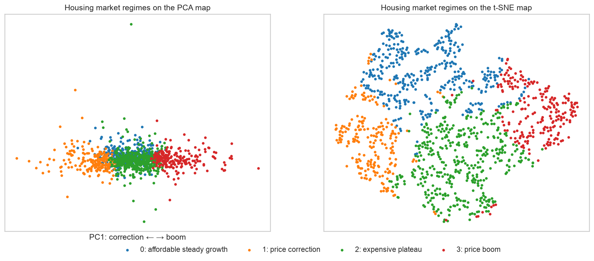
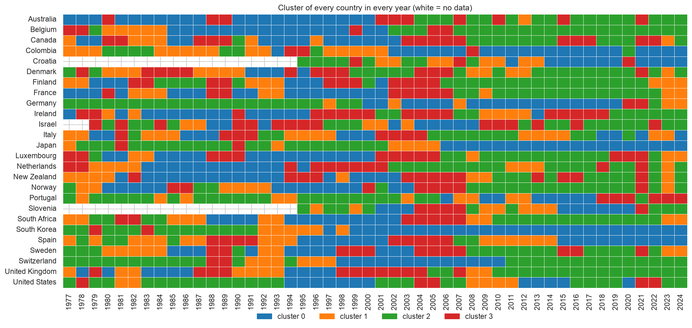
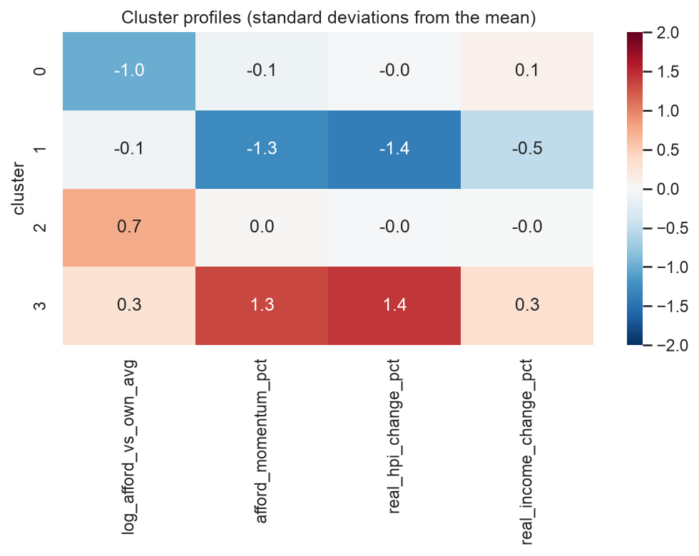

# Housing Market Regimes: 26 countries, 1977–2024

**Team:** Akshat Dayal, Bhavini Manot, Bo De Roeck (Group 8)
**Course:** AI Methods I – Day 3: Unsupervised learning (IAAC MaAI 2026/27)
**Dataset on Hugging Face:** https://huggingface.co/datasets/iaac-maai/day3-group8-housing-market-regimes
**Model on Hugging Face:** https://huggingface.co/iaac-maai/day3-group8-market-regimes

## Use case

A housing policy analyst (at a ministry, a central bank or an international body) monitors many national housing markets at once and needs a **shared vocabulary of market phases**: which countries are in a boom, which ones are correcting, which ones are stretched but stalled. We cluster every country-year in our Day 1 dataset by how prices, incomes and affordability are **moving**, relative to the country's own history, and name the resulting regimes. A regime is useful if it can be named, if it is stable, and if it suggests an action (e.g. macro-prudential measures in a boom, support for buyers in an expensive plateau).

## Dataset

| | |
|---|---|
| **Name** | Housing affordability, 26 countries (cleaned in our [Day 1 repository](https://github.com/iaac-maai/Group8-day1-assignment); same file as our [Day 2 model](https://huggingface.co/iaac-maai/day2-group8-affordability)) |
| **Source** | [Kaggle](https://www.kaggle.com/code/tolstoyjustin/forecasting-housing-affordability-to-2035/input); likely derived from the [Dallas Fed International House Price Database](https://www.dallasfed.org/research/international/houseprice) |
| **Our clustered version** | [iaac-maai/day3-group8-housing-market-regimes](https://huggingface.co/datasets/iaac-maai/day3-group8-housing-market-regimes) |
| **Rows used** | 1,210 (one row = one country in one year, 1977–2024) |
| **Licence** | CC BY-SA 4.0 (our dataset uses the same licence) |

We reuse the cleaned dataset from Day 1, so there is a single notebook. It suits an unsupervised question: it has enough rows and several meaningful numeric dynamics, and the Day 2 question (forecasting) left open *which kinds* of market years exist.

## Repository structure

```
├── data/                 # housing_affordability_model_ready.csv: the cleaned Day 1 dataset (small, committed)
├── dataset/              # dataset card (README.md) + its figures; the CSV lives on Hugging Face
├── figures/              # 12 plots exported by the notebook (01 … 12)
├── models/               # model card (README.md) + its figures; model.joblib lives on Hugging Face
├── notebook/
│   └── unsupervised_learning.ipynb   # sections 0–8 of the brief: features → PCA/t-SNE → clustering → named regimes → export
├── .gitignore
├── LICENSE               # MIT (code)
├── README.md
└── requirements.txt
```

## How to run

```bash
python -m venv .venv
source .venv/bin/activate        # Windows: .venv\Scripts\activate
pip install -r requirements.txt
```

Open `notebook/unsupervised_learning.ipynb`, select the `.venv` kernel and run all cells. The input file `data/housing_affordability_model_ready.csv` is in the repository (it was produced by the Day 1 notebook in [Group8-day1-assignment](https://github.com/iaac-maai/Group8-day1-assignment)). The notebook writes `figures/`, `models/model.joblib` and `dataset/housing_market_regimes.csv`, and runs in under a minute.

## Approach

- **Unit of analysis:** one row = one country in one year (no aggregation needed). Clustering *countries* would give only 26 rows; our users care about the phase a market is in.
- **Features clustered on:**
  - position: `log_afford_vs_own_avg` (log of affordability ÷ the country's own mean)
  - momentum: `afford_momentum_pct` (affordability vs its 3-year average)
  - `real_hpi_change_pct`
  - `real_income_change_pct`

  These are dynamics and relative positions only, because the raw indexes cannot be compared between countries.
- **Kept aside for interpretation:** country, region, year/decade, the 2007–2010 crisis flag, the raw affordability level, and **next year's affordability**.
- **Preprocessing:** log of the ratio, `StandardScaler` inside a `Pipeline`. Outliers are kept (extreme years are what users care about) and flagged with DBSCAN.
- **Methods:** PCA (3 real dimensions: boom/bust, income growth, position) and t-SNE for 2D maps. We compared K-Means, hierarchical (Ward) and DBSCAN, chose k with elbow, silhouette and dendrogram, and checked stability over random starts and 80 % subsamples.
- **Final choice:** **K-Means, k = 4**. It has the best silhouette, is stable to its random start (ARI 0.96) and gives four nameable groups of comparable size. DBSCAN shows that there are no density gaps (one cloud + 5 % outliers), so the regimes are a useful segmentation of a continuum.

## Results

| Cluster | Name | Size | Defining features (medians) |
|---|---|---|---|
| 0 | **affordable steady growth** | 364 (30 %) | affordability 23 % better than the country's average; prices +1.3 %/yr, incomes +1.8 %/yr |
| 1 | **price correction** | 209 (17 %) | real prices −6.8 %/yr; affordability improving, and still improving next year in 85 % of cases |
| 2 | **expensive plateau** | 420 (35 %) | affordability 15 % worse than the country's average, but prices and incomes flat (+1.5 % / +1.4 %); dominant regime of the 2010s–2020s |
| 3 | **price boom** | 217 (18 %) | real prices +10.1 %/yr vs incomes +2.5 %; affordability still worsening next year in 80 % of cases |



The regimes line up with history, even though the model never saw the year. Spain and Ireland go **boom (2005–06) → expensive plateau (2007–08) → correction (2009–12)**, the USA one year earlier, and Finland and Sweden follow the same sequence around their early-1990s banking crises:





## Limitations

- **A continuum, not natural groups:** the silhouette is ≈ 0.24 for every k and DBSCAN finds one dense cloud. k = 4 was chosen for interpretability.
- **Stability on subsamples:** in 2 out of 10 subsamples of 80 % of the rows, K-Means cut the data differently (ARI 0.37). The border between *affordable steady growth* and *expensive plateau* is the least certain.
- **Hindsight:** the position feature compares each year with the country's 1977–2024 average, so the regimes are a retrospective reading of history, not a real-time signal.
- **Data:** national averages of indexes (no cities, interest rates or rents), mostly high-income countries, and unreliable early years for South Korea, Israel and Croatia (most of the DBSCAN outliers).
- **Not for** forecasting, investment advice, or ranking countries by affordability level.

## AI usage disclosure

We used **Claude Code** (an AI coding assistant) to help write the notebook code, the plots and the first drafts of the README, model card and dataset card. We checked every result against the notebook outputs. The choice of features and k, and the cluster names, were reviewed by our team.

## License

Code released under the [MIT License](LICENSE). The dataset is subject to its own licence: CC BY-SA 4.0 (see above).
