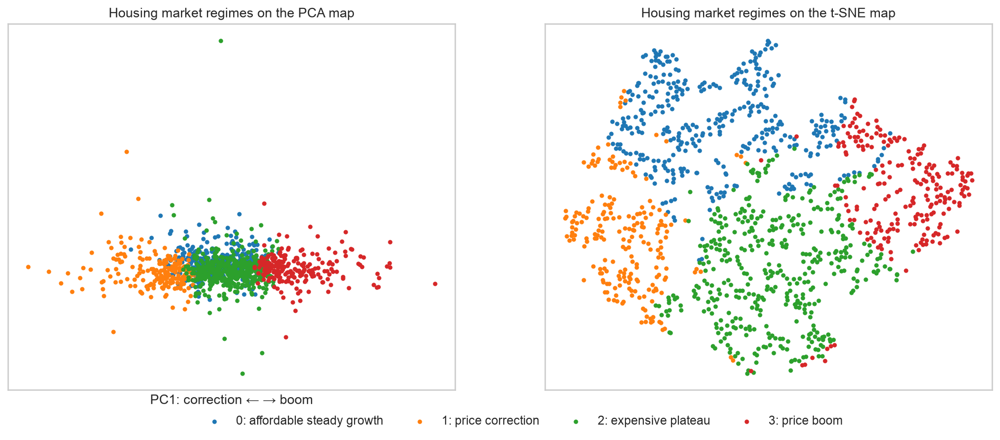
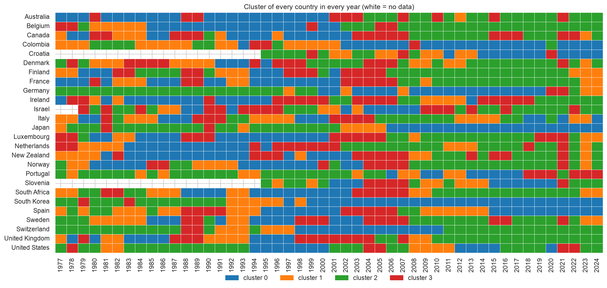
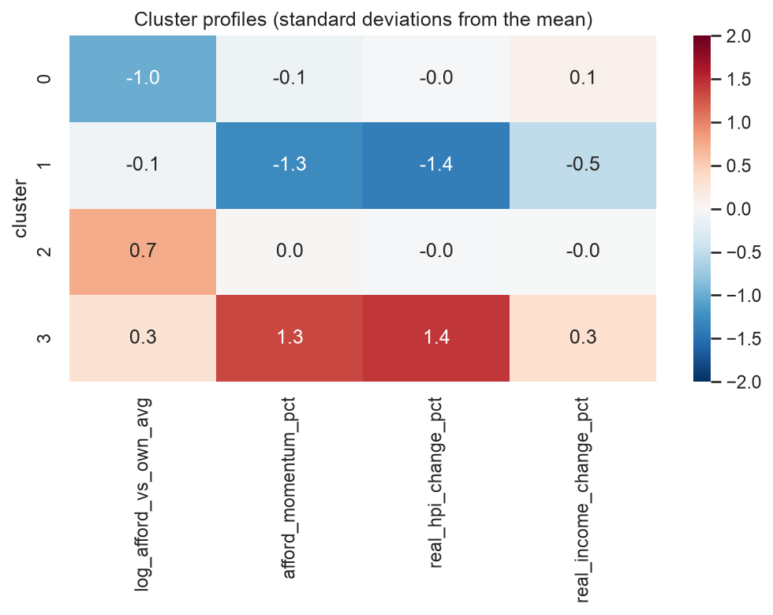

# Housing Market Regimes, 26 Countries 1977–2024

Every year of the housing market of 26 countries (1977–2024), labelled with one of four **market regimes**: *affordable steady growth*, *price correction*, *expensive plateau* or *price boom*. **One row is one country in one year** (1,210 rows). The regimes come from clustering the dynamics of real house prices, real household incomes and affordability (price-to-income ratio), relative to each country's own history. The table also contains the cleaned data, the engineered features and the 2D coordinates of the PCA and t-SNE maps, so anyone can study or redraw the regimes without rerunning the analysis.

- **GitHub repository (how it was made):** https://github.com/iaac-maai/Group08_Day03_AI-Methods (notebook `notebook/unsupervised_learning.ipynb`)
- **Model fitted on it:** https://huggingface.co/iaac-maai/day3-group8-market-regimes
- **Team:** Akshat Dayal, Bhavini Manot, Bo De Roeck

## Source and attribution

| | |
|---|---|
| **Original dataset** | *Housing affordability, 26 countries, 1975–2025*, Kaggle ([dataset used](https://www.kaggle.com/code/tolstoyjustin/forecasting-housing-affordability-to-2035/input)); the column names match the [Dallas Fed International House Price Database](https://www.dallasfed.org/research/international/houseprice) (Mack & Martínez-García, 2011), its likely original source |
| **Original licence** | CC BY-SA 4.0 |
| **Our version** | CC BY-SA 4.0 (ShareAlike: same licence as the original) |
| **Previous steps** | Cleaned by the same team on Day 1 in [Group8-day1-assignment](https://github.com/iaac-maai/Group8-day1-assignment) |

## What we changed

- **Cleaning (Day 1):** 1,326 raw rows → 1,210. Removed the hyperinflation years of Israel, Croatia and Slovenia (broken nominal indexes) and the first two years of every country (no lagged values). No missing values or duplicates remain.
- **Imputation:** none (the cleaned panel has no missing values).
- **Feature engineering (Day 3):** 4 new columns: the position of affordability relative to the country's own 1977–2024 average (`afford_vs_own_avg_pct` and its log), affordability momentum vs its 3-year average (`afford_momentum_pct`), and the change of affordability the following year (`afford_change_next_pct`). Region and country names rebuilt from the Day 1 one-hot columns; 4 constant columns dropped.
- **Clustering:** `cluster` and `cluster_name` come from the model above (StandardScaler + K-Means, k = 4) fitted on 4 features. `cluster_ward` (hierarchical, Ward, k = 4) and `dbscan_outlier` (DBSCAN, eps = 1.0, min_samples = 8) are added for comparison. The coordinates come from PCA and t-SNE.

## The clusters



| Cluster | Name | Share of the rows | What makes it different (medians) |
|---|---|---|---|
| 0 | affordable steady growth | 30.1 % (364) | Affordability **23 % better** than the country's own average; prices +1.3 %/yr and incomes +1.8 %/yr grow slowly and together |
| 1 | price correction | 17.3 % (209) | Real prices **−6.8 %/yr**, incomes flat; affordability improving fast, and still improving the next year in 85 % of cases |
| 2 | expensive plateau | 34.7 % (420) | Affordability **15 % worse** than the country's own average, but prices (+1.5 %) and incomes (+1.4 %) barely move; dominant regime of the 2010s–2020s |
| 3 | price boom | 17.9 % (217) | Real prices **+10.1 %/yr** vs incomes +2.5 %; affordability worsening fast, and still worsening the next year in 80 % of cases |

**How well separated are they?** Not sharply. The regimes are segments of a **continuum**: the silhouette score is about 0.24 for every k, and DBSCAN finds one dense cloud plus 5 % outliers. The main axis is *boom vs correction* (the first principal component, 48 % of the variance). The position relative to the country's own history is a separate direction, and it is what distinguishes *affordable steady growth* from *expensive plateau*. Without having seen the calendar, the regimes still follow known history. For example, Spain and Ireland go **boom (2005–06) → expensive plateau (2007–08) → correction (2009–12)**, the USA one year earlier, and Finland and Sweden follow the same sequence around 1990.





## Columns

| Column | Type | Unit | Description |
|---|---|---|---|
| `country` | text | – | Country name |
| `iso` | text | – | ISO 3166-1 alpha-3 code |
| `region` | text | – | Region (Western Europe, Nordic, Southern Europe, Central/Eastern Europe, North America, Latin America, Oceania, Asia, Middle East, Africa) |
| `year` | integer | year | 1977–2024 (1995–2024 for Croatia and Slovenia, 1979–2024 for Israel) |
| `decade` | integer | year | Decade of `year` (1970, 1980…) |
| `affordability` | float | index | Real house price index ÷ real disposable income index × 100. Higher = less affordable. **Not comparable between countries** |
| `affordability_next` | float | index | `affordability` of the following year |
| `real_house_price_index` | float | index | House prices adjusted for inflation |
| `real_personal_disposable_income` | float | index | Household disposable income adjusted for inflation |
| `real_hpi_change_pct` | float | % | Year-on-year change of the real house price index |
| `real_income_change_pct` | float | % | Year-on-year change of real disposable income |
| `affordability_lag1`, `affordability_lag2` | float | index | Affordability 1 and 2 years earlier |
| `affordability_3yr_avg` | float | index | Average affordability of the last 3 years (incl. this one) |
| `gfc_period` | 0/1 | – | 1 for the global financial crisis years 2007–2010 |
| `hyperinflation_country` | 0/1 | – | 1 for Israel, Croatia and Slovenia (hyperinflation years already removed) |
| `price_shock_up` | 0/1 | – | 1 if real house prices rose more than 30 % in a year (Day 1 flag) |
| `afford_vs_own_avg_pct` | float | % | Affordability relative to the country's own 1977–2024 mean (0 = normal for this country, +20 = 20 % less affordable) |
| `log_afford_vs_own_avg` | float | – | log(affordability ÷ country mean): the clustering feature version of the column above |
| `afford_momentum_pct` | float | % | Affordability vs its 3-year average (+ = getting less affordable) |
| `afford_change_next_pct` | float | % | Change of affordability the following year (**not** used for clustering; for interpretation) |
| `cluster` | integer | – | Regime number from the final model (K-Means, k = 4) |
| `cluster_name` | text | – | Name of the regime (our interpretation) |
| `cluster_ward` | integer | – | Cluster from hierarchical clustering (Ward, k = 4), for comparison. Its numbers do **not** match `cluster` |
| `dbscan_outlier` | 0/1 | – | 1 if DBSCAN (eps = 1.0, min_samples = 8, standardised features) marks the row as noise: an unusual year |
| `pca_x`, `pca_y` | float | – | Position on the first two principal components of the 4 standardised clustering features |
| `tsne_x`, `tsne_y` | float | – | Position on the t-SNE map (`perplexity=30`, `random_state=42`); only for plotting, distances between groups are not meaningful |

The four features used for clustering are `log_afford_vs_own_avg`, `afford_momentum_pct`, `real_hpi_change_pct` and `real_income_change_pct`.

## Limitations and biases

- **National averages of indexes**: no city or regional differences, and no information on interest rates, rents or housing supply, all of which matter for real affordability. Index levels cannot be compared between countries; only their dynamics can.
- **Coverage**: 26 mostly high-income countries; Africa, Latin America, Asia and the Middle East are represented by one or two countries each.
- **Hindsight**: `afford_vs_own_avg_pct` compares each year with the country's average over the whole period, including later years. The regimes are a retrospective reading of history, not a real-time signal.
- **Unreliable early years**: South Korea, Israel and Croatia in their first years are the least reliable rows. They make up most of the `dbscan_outlier = 1` rows; filter them out if needed.
- **One possible reading**: k = 4 was chosen for interpretability (the metrics do not single out a k). The border between *affordable steady growth* and *expensive plateau* is the least stable: in 2 out of 10 subsamples of 80 % of the rows, K-Means cut the data differently. Other features or another k would give other regimes.
- **Not for**: forecasting prices, investment advice, or ranking countries by how affordable they are.

## How to load it

```python
import pandas as pd
import matplotlib.pyplot as plt

df = pd.read_csv("hf://datasets/iaac-maai/day3-group8-housing-market-regimes/housing_market_regimes.csv")

# the regimes on the t-SNE map
for name, rows in df.groupby("cluster_name"):
    plt.scatter(rows["tsne_x"], rows["tsne_y"], s=8, label=name)
plt.legend()
plt.show()

# one country's history
df[df["country"] == "Spain"][["year", "cluster_name"]].tail(20)
```

## Related

- GitHub repository with the notebook: https://github.com/iaac-maai/Group08_Day03_AI-Methods
- Fitted model (assign a new country-year to a regime): https://huggingface.co/iaac-maai/day3-group8-market-regimes
- Day 2 model (forecasting next year's affordability): https://huggingface.co/iaac-maai/day2-group8-affordability

## Authors and licence

Akshat Dayal, Bhavini Manot, Bo De Roeck. Course assignment for **AI Methods I: Machine Learning for the Built Environment**, IAAC MaAI 2026/27.

Released under **CC BY-SA 4.0**, based on the Kaggle dataset *Housing affordability, 26 countries, 1975–2025* (CC BY-SA 4.0), itself likely derived from the Dallas Fed International House Price Database.
