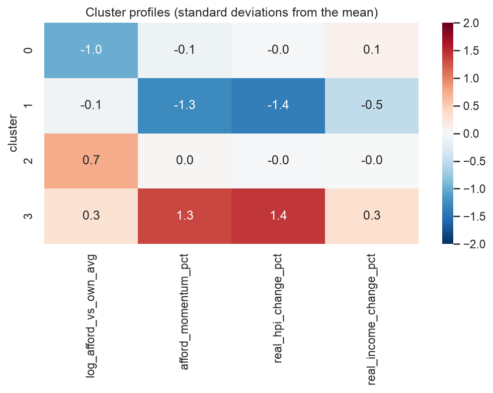

# Housing market regimes: grouping country-years by price, income and affordability dynamics

This model places one year of a national housing market (a *country-year*) into one of **four market regimes**: *affordable steady growth*, *price correction*, *expensive plateau* or *price boom*. It uses four features: real house price growth, real income growth, affordability momentum, and affordability relative to the country's own long-run average. It is a scikit-learn pipeline (StandardScaler + K-Means, k = 4) fitted on 1,210 country-years from 26 countries (1977–2024). It is meant for housing policy analysts who want a common vocabulary for market phases across countries. It was built as a course assignment for AI Methods I (IAAC MaAI 2026/27).

- **GitHub repository (full analysis):** https://github.com/iaac-maai/Group08_Day03_AI-Methods (notebook `notebook/unsupervised_learning.ipynb`)
- **Clustered dataset:** https://huggingface.co/datasets/iaac-maai/day3-group8-housing-market-regimes
- **Team:** Akshat Dayal, Bhavini Manot, Bo De Roeck

## Intended use

- **Intended users and use:** analysts at a ministry, central bank or international organisation, or students and researchers, who want to label the phase of a national housing market (e.g. "Spain 2006 was a *price boom*") and compare cycles across countries and decades.
- **Out-of-scope uses:**
  - **Forecasting** prices or affordability, and investment decisions. The regimes describe a year; they do not predict the next one (see the [Day 2 model](https://huggingface.co/iaac-maai/day2-group8-affordability) for that).
  - **Ranking countries** by affordability. The inputs are relative to each country's own history, and the underlying indexes cannot be compared between countries.
  - **Cities, regions** or individual properties. The model was fitted on national averages only.
  - Countries that are not in the training data, or that have only a few years of history: the main feature needs a long-run average to compare against.

## Model details

| | |
|---|---|
| **Task** | Clustering (unsupervised) |
| **Algorithm** | K-Means |
| **Key hyperparameters** | `n_clusters=4`, `n_init=10`, `random_state=42` |
| **Preprocessing** | `StandardScaler` on the 4 features (inside the pipeline). The log of the affordability ratio is computed **before** the model (see *Input features*) |
| **Assigner** | Not needed: K-Means assigns new rows to the nearest centroid with `.predict()` |
| **File** | `model.joblib`: the whole fitted scikit-learn `Pipeline` (`StandardScaler` → `KMeans`) |
| **Library versions** | scikit-learn 1.9.0, pandas 3.0.3, numpy 2.4.6, joblib 1.5.3, Python 3.14 |

## Input features

The model expects a `pandas.DataFrame` with exactly these columns:

| Column | Type | Unit | Description | Preprocessing |
|---|---|---|---|---|
| `log_afford_vs_own_avg` | numeric | – | `log(affordability / mean affordability of the same country over 1977–2024)`, with affordability = real house price index ÷ real disposable income index × 100. 0 = normal for this country, `log(1.2)` ≈ 0.18 = 20 % less affordable than usual | computed by the user, then scaling |
| `afford_momentum_pct` | numeric | % | `(affordability / average affordability of the last 3 years, incl. this one − 1) × 100`. Positive = getting less affordable | scaling |
| `real_hpi_change_pct` | numeric | % | Year-on-year change of the real (inflation-adjusted) house price index | scaling |
| `real_income_change_pct` | numeric | % | Year-on-year change of real disposable household income | scaling |

## Output and clusters

`model.predict(X)` returns the regime number of each row:

| Cluster | Name | Share of the data | Defining features (medians) |
|---|---|---|---|
| 0 | affordable steady growth | 30.1 % | Affordability 23 % better than the country's average; prices +1.3 %/yr and incomes +1.8 %/yr grow together; no momentum |
| 1 | price correction | 17.3 % | Real prices −6.8 %/yr, incomes flat (−0.1 %); affordability improving fast (momentum −6.3 %) |
| 2 | expensive plateau | 34.7 % | Affordability 15 % worse than the country's average, but prices (+1.5 %) and incomes (+1.4 %) barely move; momentum flat |
| 3 | price boom | 17.9 % | Real prices +10.1 %/yr vs incomes +2.5 %; affordability worsening fast (momentum +6.9 %) |

There is no noise label: every input is assigned to one of the four regimes, including unusual years.



## Training data

| | |
|---|---|
| **Dataset** | Housing affordability, 26 countries (Kaggle), cleaned on Day 1 in [Group8-day1-assignment](https://github.com/iaac-maai/Group8-day1-assignment) |
| **Source** | [original](https://www.kaggle.com/code/tolstoyjustin/forecasting-housing-affordability-to-2035/input) (likely from the Dallas Fed International House Price Database) · [our clustered version](https://huggingface.co/datasets/iaac-maai/day3-group8-housing-market-regimes) |
| **Licence** | CC BY-SA 4.0 |
| **One row is** | One country in one year |
| **Size used** | 1,210 rows |
| **Coverage** | 26 countries (mostly OECD; also Colombia, South Africa, Croatia, Slovenia), 1977–2024 |

**Cleaning and feature engineering:** the hyperinflation years of Israel, Croatia and Slovenia and the first two years of every country were removed on Day 1 (1,326 → 1,210 rows); there are no missing values. Two features were added on Day 3: the log of affordability relative to the country's own mean, and affordability momentum relative to its 3-year average.

## Method and evaluation

- **Methods compared:** K-Means, hierarchical clustering (Ward) and DBSCAN, all on the 4 standardised features. Agreement between K-Means and Ward: **ARI = 0.35**. DBSCAN found a single dense cluster plus 5 % noise for every eps from 0.6 to 1.2, which shows the data is a continuum rather than separate groups.
- **Choice of k:** no k stands out. The silhouette is between 0.21 and 0.27 for every k from 2 to 10 (0.24 at k = 4), the elbow is gradual, and the dendrogram's tall merges stop below 3–4 clusters. We chose **k = 4** for interpretability: with k = 5 the extra cluster is only 31 extreme years, and with k = 6 the new groups were hard to tell apart.
- **Stability:** across 10 random starts the mean ARI is **0.96** (minimum 0.93). Across 10 random subsamples of 80 % of the rows the mean ARI is **0.75**: in 8 of the 10 the result is 0.80–0.89, but 2 produced a different cut (0.37–0.38). Ward was much less stable (mean 0.38).
- **External check (variables not used for clustering):** after a *price boom* year, affordability worsens again the next year in 80 % of cases. After a *price correction* year, it keeps improving in 85 % of cases. Known episodes (Spain and Ireland in 2005–2012, the USA a year earlier; Finland and Sweden around 1990) follow the sequence boom → expensive plateau → correction.
- **Why this model:** it has the highest silhouette of the three, it is very stable to its random start, its four groups are of comparable size and each has a clear economic meaning, and it can assign new rows directly with `.predict()`.

## Limitations and biases

- **A segmentation of a continuum, not natural groups.** Rows near a border can switch regime with small changes in the data. The border between *affordable steady growth* and *expensive plateau* is the least certain.
- **Hindsight.** The main feature compares a year with the country's 1977–2024 average, which includes later years. Applying the model to a new year requires choosing a reference average yourself, and that choice changes the result.
- **Limited inputs.** National averages of indexes only: no interest rates, rents, supply or regional differences. A "boom" in these terms says nothing about *why* prices rise.
- **Coverage bias.** The data covers mostly high-income countries. The early years of South Korea, Israel and Croatia are unusual and the least reliable (they make up most of the DBSCAN outliers), yet the model still assigns them to one of the four regimes.
- **Our interpretation.** The names describe the medians of each cluster. Individual country-years inside a cluster can differ from that profile.

## How to use

```python
import joblib
import numpy as np
import pandas as pd
from huggingface_hub import hf_hub_download

path = hf_hub_download(repo_id="iaac-maai/day3-group8-market-regimes", filename="model.joblib")
model = joblib.load(path)

CLUSTER_NAMES = {0: "affordable steady growth", 1: "price correction",
                 2: "expensive plateau", 3: "price boom"}

example = pd.DataFrame([{
    "log_afford_vs_own_avg": np.log(1.30),   # 30 % less affordable than the country's long-run average
    "afford_momentum_pct": 5.0,              # 5 % worse than the average of the last 3 years
    "real_hpi_change_pct": 9.0,              # real house prices +9 % this year
    "real_income_change_pct": 1.0,           # real incomes +1 % this year
}])
cluster = model.predict(example)[0]
print(cluster, CLUSTER_NAMES[cluster])       # -> 3 price boom
```

⚠️ `.joblib` files are Python pickles and can run code when loaded: only load models from sources you trust. Use the library versions listed above; the model may not load with other versions of scikit-learn.

## Reproducibility

The full analysis (data loading, feature engineering, PCA, t-SNE, three clustering algorithms, stability, interpretation) is in the GitHub repository: https://github.com/iaac-maai/Group08_Day03_AI-Methods. Run `notebook/unsupervised_learning.ipynb` with the packages in `requirements.txt`. All randomness uses `random_state=42`.

## Authors and licence

Akshat Dayal, Bhavini Manot, Bo De Roeck. Course assignment for **AI Methods I: Machine Learning for the Built Environment**, IAAC MaAI 2026/27.

Model released under the MIT License. The training data is subject to its own licence: CC BY-SA 4.0 (see the dataset above).
